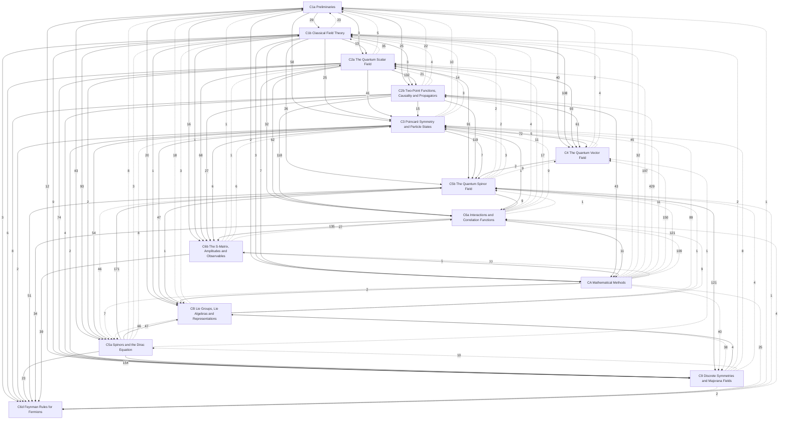

# Quantum Field Theory

Relativistic quantum field theory at the graduate level (**C**, PHY 513, Larsen, Fall 2026; textbook Peskin & Schroeder). Chapters follow Yu Zhao-Huan's lecture notes (余钊焕《量子场论讲义》), whose chapter numbers they keep: fields are organized by spin after the Poincaré group, and interactions are treated once for all fields. Each concept has one home: statements are short boxes, derivations are folded under them, explanations are titled remarks, and hidden connections are collected in each note's Connections. Multi-step procedures have their own notes in Procedures/, linked from every place they are carried out. Statements are marked by layer: *principles* (postulated), *theorems* (derived, with a derivation and a *Uses:* line) and *models* (idealized systems). ★ marks material beyond the PHY 513 syllabus; a *draft* banner marks syllabus topics written ahead of the lectures. Relativity is in [[Relativity]], one-particle quantum mechanics in [[Quantum Mechanics]]. Procedures: [[P1 Canonical Quantization]], [[P2 Green's Functions by Contour Integration]], [[P3 Noether's Procedure]], [[P4 Restoring ħ and c]], [[P5 Symmetry Factor of a Diagram]], [[P6 Tree Amplitude from a Lagrangian]], [[P7 From ℳ to σ or Γ]]. Reference cards: [[Scalar Field Card]], [[Vector Field Card]], [[Spinor Field Card]]. Two mathematics chapters collect the tools the physics uses: [[· CA Mathematical Methods]] (limits, generalized functions, Fourier transforms, contours) and [[· CB Lie Groups, Lie Algebras and Representations]] (Lie groups and algebras, complexification, representations, Clifford algebras and the spin groups). The course order, lecture by lecture, is in [[PHY 513 Course Log]], the annotated midterm sheet in [[PHY 513 Midterm Cheatsheet]], the midterm review in [[PHY 513 Midterm Review]] with its drills [[PHY 513 PS Drill]] and [[PHY 513 Notes Drill]]; conventions in [[Larsen PHY 513]].

## Level C — graduate
- [[· C1a Preliminaries]]
- [[· C1b Classical Field Theory]]
- [[· C2a The Quantum Scalar Field]]
- [[· C2b Two-Point Functions, Causality and Propagators]]
- [[· C3 Poincaré Symmetry and Particle States]] (★ §C3.6, §C3.7)
- [[· C4 The Quantum Vector Field]] (★ §C4.2, §C4.3, §C4.4, §C4.5)
- [[· C5a Spinors and the Dirac Equation]]
- [[· C5b The Quantum Spinor Field]]
- [[· C6a Interactions and Correlation Functions]]
- [[· C6b The S-Matrix, Amplitudes and Observables]]
- [[· C6d Feynman Rules for Fermions]] (★ §C6d.6)
- [[· C9 Discrete Symmetries and Majorana Fields]]
- [[· CA Mathematical Methods]]
- [[· CB Lie Groups, Lie Algebras and Representations]] (★ §CB.20)

### How the chapters build on each other
Arrows point from a chapter to the chapters that use it; labels count the citations from statements, derivations and *Uses:* lines. Dashed arrows are forward references.

## Planned
Chapters without notes yet (Yu's numbering). C6 Interactions of quantum fields is written through Lecture 15 and Problem Set 8, split on 2026-10-31 into C6a Interactions and Correlation Functions and C6b The S-Matrix, Amplitudes and Observables (C6a: §C6a.1–§C6a.4: φ⁴ theory, the interaction picture, the Dyson series, the interacting vacuum and the master formula; §C6a.5–§C6a.11: normal ordering, Wick's theorem, Feynman diagrams and rules for correlation functions in position and momentum space, symmetry factors, the iε limit and the cancellation of vacuum bubbles, with the combinatorics in §CA.7; §C6a.12: the rules for any polynomial interaction; C6b: §C6b.1–§C6c.7: the S-matrix and the invariant amplitude, matrix elements between particle states and the tree-level rules, cross sections by Yu's box route (main line, user decision 2026-10-31) and from wave packets, Lorentz invariance and two-body phase space, decay rates and widths, amplitudes as amputated correlation functions, particle production by a classical source); the Feynman propagators of the other fields (Yu §6.4) are planned there. C6d Feynman Rules for Fermions (Lecture 17, 2026-11-04) holds the fermion rules: Yukawa theory, external spinors, Wick's theorem with signs, the rules for iℳ, ff → ff and ★ the Yukawa potential; the QED rules (Lecture 18) follow in C6d, the processes in C8 (user decision 2026-11-04: the planned C7 Feynman diagrams is dissolved, S-matrix rules in C6b, fermion and QED rules in C6d).

**Level C — PHY 513 (Larsen, Fall 2026; Peskin & Schroeder; Yu)**
C8 Quantum electrodynamics (processes; the QED Feynman rules of Lecture 18 go to C6d) · C9 Discrete symmetries and Majorana fields (written: parity §C9.1–§C9.5, charge conjugation §C9.6–§C9.7, physical spin §C9.8, time reversal §C9.9–§C9.10, CPT §C9.11, C, T and CPT of the complex scalar field §C9.12; Majorana fields pending) · C10 The S-matrix and correlation functions (LSZ; the S-matrix, cross sections and decay rates themselves are in C6b §C6b.1–§C6c.1) · C11 Path-integral quantization · *Second semester* (PHY 513 Lecture 17, slide 26: renormalization, "a deep principle: much more in 2nd semester"): loop integrals, regularization (dimensional regularization), renormalization, Cutkosky cuts; the dimension count that sorts couplings into renormalizable and nonrenormalizable is already in [[§C1b.3 Mass Dimension, Locality and Power Counting|§C1b.3]] and [[§C6d.1 Yukawa Theory|§C6d.1]]

**Mathematics chapter CB** (started 2026-10-08; sections renumbered §CB.0–§CB.21 for "option 1", physics refers to mathematics; §CB.1 split on 2026-10-08, its SU(2)/SO(3) part is now §CB.2): [[· CB Lie Groups, Lie Algebras and Representations]] has its full logical chain (every definition and theorem, in order, with course boxes embedded) and proofs, except those still marked *Proof (to be filled)* (the Lie correspondence in §CB.3, Bargmann's theorem in §CB.19, Mackey and Wigner–Mackey in §CB.20★); the mathematical statements of C3 moved into CB in batch B1 (2026-10-08; C3 regrouped into §C3.1–§C3.5 with "The mathematics used here" blocks), those of C5a moved in batch B2 (2026-10-08; the Lorentz-algebra section split, now §CB.5–§CB.6; §C5a.0–§C5a.14 and §C9.4 with "The mathematics used here" blocks; §CB.0, linear algebra in components, holds the statements of spinor-space layer 1), and those of C1a and C9 (the matrix groups, the components of the Lorentz group and the identity component, the discrete element of O(3), and the dual space, multilinear tensors and their transformation law) moved in batch B3 (2026-10-08; "The mathematics used here" blocks in §C1a.3–§C1a.7, §C1b.1 and §C9.1; the preview folder of the option-1 demo removed): **option 1 is done**. Since the physics-form rollout (2026-11-02, user-approved demos §C5a.1 and §C3.2) physics sections no longer embed CB or CA statements and the "The mathematics used here" blocks are gone: each structure is stated in the Model or Definition that uses it with a link to its CB/CA home, each judgement tool is a physics statement box whose *Proof:* links CB, and the CB/CA items a section relies on are listed, with what each guarantees there, in a folded *Mathematical background* block at the end of the section, before Connections. §CB.21 Grassmann algebras is completed with C11 (the two ★ Grassmann boxes of §C5b.1 move then).
