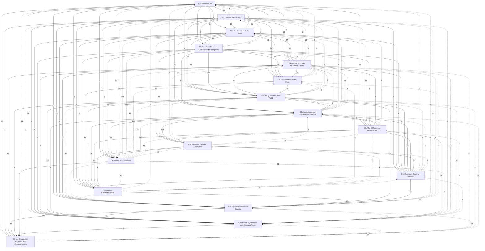

# Quantum Field Theory

Relativistic quantum field theory at the graduate level (**C**, PHY 513, Larsen, Fall 2026; textbook Peskin & Schroeder). Chapters follow Yu Zhao-Huan's lecture notes (余钊焕《量子场论讲义》), whose chapter numbers they keep: fields are organized by spin after the Poincaré group, and interactions are treated once for all fields. Each concept has one home: statements are short boxes, derivations are folded under them, explanations are titled remarks, and hidden connections are collected in each note's Connections. Multi-step procedures have their own notes in Procedures/, linked from every place they are carried out. Statements are marked by layer: *principles* (postulated), *theorems* (derived, with a derivation and a *Uses:* line) and *models* (idealized systems). ★ marks material beyond the PHY 513 syllabus; a *draft* banner marks syllabus topics written ahead of the lectures. Relativity is in [[Relativity]], one-particle quantum mechanics in [[Quantum Mechanics]]. Procedures: [[P1 Canonical Quantization]], [[P2 Green's Functions by Contour Integration]], [[P3 Noether's Procedure]], [[P4 Restoring ħ and c]], [[P5 Symmetry Factor of a Diagram]], [[P6 Tree Amplitude from a Lagrangian]], [[P7 From ℳ to σ or Γ]]. Reference cards: [[Scalar Field Card]], [[Vector Field Card]], [[Spinor Field Card]]. Two mathematics chapters collect the tools the physics uses: [[· CA Mathematical Methods]] (limits, generalized functions, Fourier transforms, contours, Gaussian and Bessel integrals, iε boundary values, pairings and symmetry factors, the exponential formula) and [[· CB Lie Groups, Lie Algebras and Representations]] (Lie groups and algebras, complexification, representations, Clifford algebras and the spin groups). The course order, lecture by lecture, is in [[PHY 513 Course Log]], the annotated midterm sheet in [[PHY 513 Midterm Cheatsheet]], the midterm review in [[PHY 513 Midterm Review]] with its drills [[PHY 513 PS Drill]] and [[PHY 513 Notes Drill]]; conventions in [[Larsen PHY 513]].

## Level C — graduate
- [[· C1a Preliminaries]]
- [[· C1b Classical Field Theory]]
- [[· C2a The Quantum Scalar Field]]
- [[· C2b Two-Point Functions, Causality and Propagators]]
- [[· C3 Poincaré Symmetry and Particle States]] (★ §C3.6, §C3.7)
- [[· C4 The Quantum Vector Field]] (★ §C4.2, §C4.3, §C4.4, §C4.5)
- [[· C5a Spinors and the Dirac Equation]]
- [[· C5b The Quantum Spinor Field]]
- [[· C6a Interactions and Correlation Functions]]
- [[· C6b The S-Matrix and Observables]]
- [[· C6c Feynman Rules for Amplitudes]]
- [[· C6d Feynman Rules for Fermions]]
- [[· C8 Quantum Electrodynamics]]
- [[· C9 Discrete Symmetries and Majorana Fields]]
- [[· CA Mathematical Methods]]
- [[· CB Lie Groups, Lie Algebras and Representations]] (★ §CB.22)

### How the chapters build on each other
Arrows point from a chapter to the chapters that use it; labels count the citations from statements, derivations and *Uses:* lines. Dashed arrows are forward references.

## Planned
Yu's chapter 6, Interactions of quantum fields, and his chapter 7, Feynman diagrams, are written as four chapters (through Lecture 18 and Problem Set 9): C6a Interactions and Correlation Functions (§C6a.0: setups and observables; §C6a.1–§C6a.5: φ⁴ theory, the interaction picture, the Dyson series, the interacting vacuum and the master formula; §C6a.6–§C6a.12: normal ordering, Wick's theorem, Feynman diagrams and rules for correlation functions in position and momentum space, symmetry factors, the iε limit and the cancellation of vacuum bubbles, with the combinatorics in §CA.8–§CA.9; §C6a.13: the exponential of the connected vacuum bubbles and the vacuum energy density; §C6a.14: the rules for any polynomial interaction); C6b The S-Matrix and Observables (§C6b.1–§C6b.9 in Yu §6.5's order: the S-matrix and the invariant amplitude, transition probabilities in a box, the cross section, two-body scattering kinematics, decay widths, decay kinematics (★ three-body), the width in the propagator, and the cross section from wave packets); C6c Feynman Rules for Amplitudes (§C6c.1–§C6c.8: amplitudes as amputated correlation functions, matrix elements between particle states and the Feynman rules for amplitudes, particle production by a classical source); C6d Feynman Rules for Fermions (Lecture 17, after Yu §7.1–§7.2, mirroring C6c: Yukawa theory, contractions with external fermions, Wick's theorem with signs and the contraction rule, first and second order, the momentum-space rules, and the Yukawa potential, §C6d.7, taught in Lecture 18). The Feynman propagators of the other fields (Yu §6.4) are with their fields: complex scalar [[§C6a.8 Feynman Diagrams for Correlation Functions#^thm-c6a-8-2|Theorem §C6a.8.2]], vector fields [[§C4.11 Vector-Field Propagators|§C4.11]] and [[§C8.3 Photon Lines꞉ the Quantized Photon Field, Polarizations and the Propagator#^thm-c8-3-5|Theorem §C8.3.5]], Dirac field [[§C5b.8 Green's Functions and the Dirac Feynman Propagator#^thm-c5b-8-3|Theorem §C5b.8.3]]. The planned C7 Feynman diagrams is dissolved (user decision 2026-11-04: S-matrix rules in C6b and C6c, fermion rules in C6d). C8 Quantum Electrodynamics is started (user decision 2026-11-09): written §C8.1–§C8.5 (Lecture 18), the Lagrangian and the covariant derivative, gauge invariance, photon lines, the QED Feynman rules, the Coulomb potential and why like charges repel, and §C8.6–§C8.9 (Lecture 19), the first process $e^+e^- \to \mu^+\mu^-$: the amplitude and the virtual photon, the spin-averaged square by traces, the unpolarized cross section, quark–antiquark production and the ratio $R$; the QED processes of Lectures 20–22 (helicity structure, crossing symmetry, Compton scattering), the Ward identity and the quantization of the electromagnetic field in the course (Lecture 25) are pending.

**Level C — PHY 513 (Larsen, Fall 2026; Peskin & Schroeder; Yu)**
Chapters without notes yet, or with parts pending (Yu's numbering): C8 Quantum electrodynamics (written: §C8.1–§C8.9, Lectures 18–19; QED processes of Lectures 20–22 pending) · C9 Discrete symmetries and Majorana fields (written: parity §C9.1–§C9.5, charge conjugation §C9.6–§C9.7, physical spin §C9.8, time reversal §C9.9–§C9.10, CPT §C9.11, C, T and CPT of the complex scalar field §C9.12, time reversal of the S-matrix and detailed balance §C9.13; Majorana fields pending) · C10 The S-matrix and correlation functions (LSZ; the S-matrix, cross sections and decay rates themselves are in C6b §C6b.1–§C6b.9) · C11 Path-integral quantization · *Second semester* (PHY 513 Lecture 17, slide 26: renormalization, "a deep principle: much more in 2nd semester"): loop integrals, regularization (dimensional regularization), renormalization, Cutkosky cuts; the dimension count that sorts couplings into renormalizable and nonrenormalizable is already in [[§C1b.3 Mass Dimension, Locality and Power Counting|§C1b.3]] and [[§C6d.1 Yukawa Theory|§C6d.1]]

**Mathematics chapter CB**: [[· CB Lie Groups, Lie Algebras and Representations]] (§CB.0–§CB.23) has its full logical chain, every definition and theorem in reading order, and proofs, except those still marked *Proof (to be filled)* (the Lie correspondence in §CB.3, Bargmann's theorem in §CB.21, Mackey and Wigner–Mackey in §CB.22★). The layout is "physics refers to mathematics" (option 1, 2026-10-08; physics form since the rollout of 2026-11-02, user-approved demos §C5a.1 and §C3.2): the mathematical statements of C1a, C3, C5a and C9 have their homes in CB (the matrix groups, the components of the Lorentz group and the identity component, the discrete element of O(3), the dual space, multilinear tensors and their transformation law; §CB.0, linear algebra in components, holds the statements of spinor-space layer 1; the SU(2)/SO(3) part is §CB.2, the Lorentz algebra §CB.5–§CB.6), and CB rests only on CB, CA and the Math notes, with two exceptions embedded from the physics chapters: the orbit theorem of §C1a.4 in §CB.22★ and the ★ Grassmann boxes of §C5b.1 in §CB.23. Physics sections do not embed CB or CA statements: each structure is stated in the Model or Definition that uses it with a link to its CB/CA home, each judgement tool is a physics statement box whose *Proof:* links CB, and the CB/CA items a section relies on are listed, with what each guarantees there, in a folded *Mathematical background* block at the end of the section, before Connections. §CB.23 Grassmann algebras is completed with C11 (the two ★ Grassmann boxes of §C5b.1 move then).
