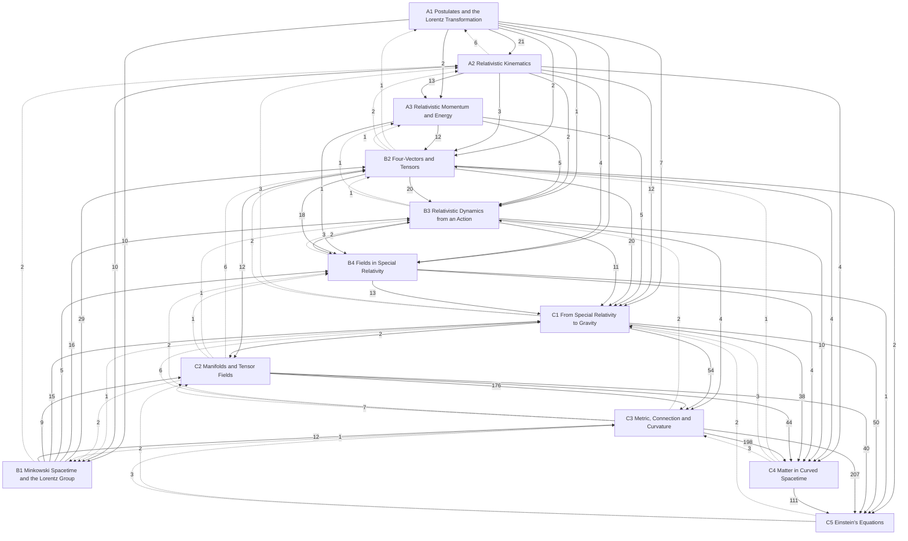

# Relativity

Special relativity from Einstein's postulates, then its covariant (tensor) form, then general relativity, in three levels: **A** introductory (University Physics Vol. 3 ch. 5; Tipler & Llewellyn ch. 1–2; Morin; PHY 284), **B** upper-level: special relativity in covariant form (the user's own PHY 505 notes and lecture-notes series Part III; PHY 505; Morin, Schutz and Griffiths ch. 12 as supplements), **C★** graduate: general relativity, self-study (no GR course taken; spine Couzens' Oxford lecture notes GR1–GR2, textbooks d'Inverno & Vickers — the textbook of UMich PHYSICS 435/535, whose syllabus serves as a scope reference — Hartle, Schutz and 't Hooft; typed PHY 360 homework as examples). Statements are marked by layer: *principles* (assumed), *laws* (empirical, with their range), *theorems* (derived, with a derivation and a *Uses:* line) and *models* (idealisations). Level B uses the signature η = diag(+1, −1, −1, −1) and keeps c explicit; level C uses η = diag(−1, 1, 1, 1) and geometric units G = c = 1, with the dictionary in §C1.2 and the register [[General Relativity Conventions]]. Newtonian mechanics is in [[Classical Mechanics]], electromagnetism in [[Electromagnetism]]; the covariant formulation of electrodynamics proper (Maxwell from a Lagrangian, the field energy–momentum tensor) is Electromagnetism level C, and §B4.2 here applies the tensor machinery to the field tensor.

## Level A — introductory
- [[· A1 Postulates and the Lorentz Transformation]]
- [[· A2 Relativistic Kinematics]]
- [[· A3 Relativistic Momentum and Energy]]

## Level B — upper
- [[· B1 Minkowski Spacetime and the Lorentz Group]]
- [[· B2 Four-Vectors and Tensors]]
- [[· B3 Relativistic Dynamics from an Action]]
- [[· B4 Fields in Special Relativity]]

## Level C★ — general relativity (self-study)
- [[· C1 From Special Relativity to Gravity]]
- [[· C2 Manifolds and Tensor Fields]]
- [[· C3 Metric, Connection and Curvature]]
- [[· C4 Matter in Curved Spacetime]]
- [[· C5 Einstein's Equations]]

### How the chapters build on each other
Arrows point from a chapter to the chapters that use it; labels count the citations from statements, derivations and *Uses:* lines. Dashed arrows are forward references.

## Planned
Chapters without notes yet; sources in brackets. Planned: 14 chapters, 78 sections.

**Level C★ — general relativity (self-study)**
C6 The Schwarzschild solution and the classical tests [GR1 §6.1–6.2; Hartle 9–10; d'Inverno 15–16] · C7 Schwarzschild as a black hole [GR1 §6.3; d'Inverno 17] · C8 Linearised gravity and gravitational waves [Couzens GR2 §2; Schutz 9; d'Inverno 21] · C9 Relativistic stars and collapse [GR2 §3; Schutz 10] · C10 Causal structure and Penrose diagrams [GR2 §4; d'Inverno 18] · C11 Charged black holes [GR2 §5; d'Inverno 19] · C12 Rotating black holes [GR2 §6; d'Inverno 20; Hartle 15] · C13 Black-hole thermodynamics [GR2 §7] · C14 Hawking radiation and quantum fields in curved spacetime [GR2 §8–9] · C15 Cosmology [Hartle 17–19; Schutz 13; d'Inverno 24–26; 't Hooft 14 — planned only, not yet scheduled]
