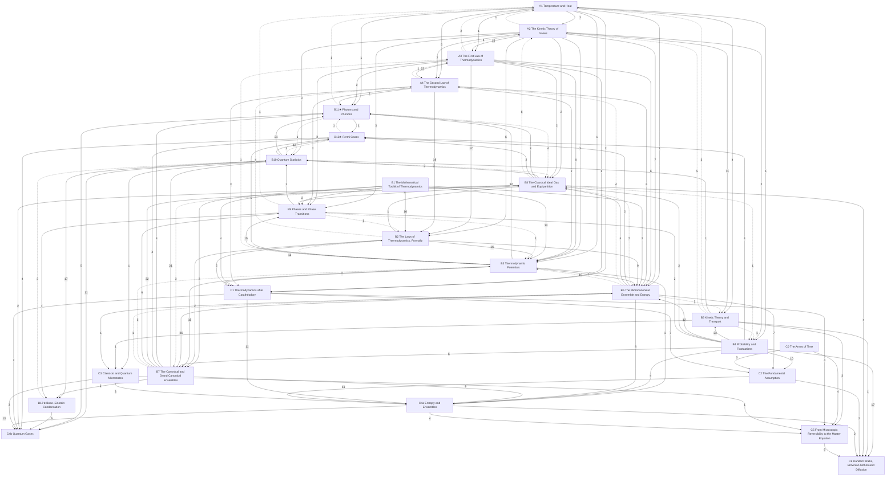

# Thermal and Statistical Physics

Temperature, heat, the kinetic theory of gases and the laws of thermodynamics, then statistical mechanics, in three levels: **A** introductory (University Physics Vol. 2; PHY 287), **B** upper-level (PHY 306; Schroeder; Blundell; Schwartz's statistical-mechanics lectures; the user's own notes), **C** graduate (PHY 510, Mao, chapters following the course notes; conventions in [[Mao PHY 510]], lectures in [[PHY 510 Course Log]]). Statements are marked by layer: *principles* (assumed), *laws* (empirical, with their range), *theorems* (derived, with a derivation and a *Uses:* line) and *models* (idealisations). The mechanics it uses is in [[Classical Mechanics]]. At level B, ★ marks material beyond the course (PHY 306: its syllabus, problem sets and the user's notes): whole sections are starred in the lists below, and folded ★ callouts inside a section are side topics.

## Level A — introductory
- [[· A1 Temperature and Heat]]
- [[· A2 The Kinetic Theory of Gases]]
- [[· A3 The First Law of Thermodynamics]]
- [[· A4 The Second Law of Thermodynamics]]

## Level B — upper
- [[· B1 The Mathematical Toolkit of Thermodynamics]]
- [[· B2 The Laws of Thermodynamics, Formally]]
- [[· B3 Thermodynamic Potentials]] (★ §B3.4)
- [[· B4 Probability and Fluctuations]]
- [[· B5 Kinetic Theory and Transport]] (★ §B5.2, §B5.3, §B5.4)
- [[· B6 The Microcanonical Ensemble and Entropy]]
- [[· B7 The Canonical and Grand Canonical Ensembles]]
- [[· B8 The Classical Ideal Gas and Equipartition]]
- [[· B9 Phases and Phase Transitions]] (★ §B9.2, §B9.3)
- [[· B10 Quantum Statistics]]
- [[· B11★ Photons and Phonons]]
- [[· B12★ Bose–Einstein Condensation]]
- [[· B13★ Fermi Gases]]

## Level C — graduate
- [[· C0 The Arrow of Time]]
- [[· C1 Thermodynamics after Carathéodory]]
- [[· C2 The Fundamental Assumption]]
- [[· C3 Classical and Quantum Microstates]]
- [[· C4a Entropy and Ensembles]] (★ §C4a.9)
- [[· C4b Quantum Gases]] (★ §C4b.9)
- [[· C5 From Microscopic Reversibility to the Master Equation]]
- [[· C6 Random Walks, Brownian Motion and Diffusion]]

### How the chapters build on each other
Arrows point from a chapter to the chapters that use it; labels count the citations from statements, derivations and *Uses:* lines. Dashed arrows are forward references.

## Planned
Chapters without notes yet. Level C follows the chapters of Mao's PHY 510 notes.

**Level C — graduate** (C0–C6 are written, above; Units 1 and 2 of PHY 510)
Unit 3 chapters (emergence of order, fluctuations and criticality, complexity, physics of learning) as they are lectured. The density operator has its home in [[· C11 Density Matrices and Entanglement|QM C11]].
